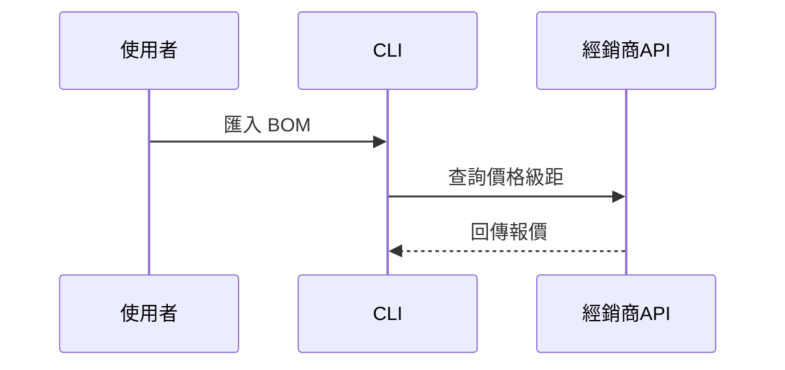

PR 內文使用繁體中文撰寫；程式碼、檔名、指令維持原文。使用以下範本：

```markdown
## 摘要

<示意圖、diff 草圖或樹狀圖>

## 證據

- **之前：** <截圖／輸出／失敗的測試結果>
  **之後：** <截圖／輸出／通過的測試結果>

## 合併風險

**門：** <單向門或雙向門>

<選填：說明>

**影響範圍：** <一個詞的描述>

<選填：合併可能帶來的後果>
```

## 各段說明

跳過所有開場白，文字保持簡短。使用 `GLOSSARY.md` 中使用者的領域語言。

### 摘要

選擇能把重點講清楚的最小視圖。

- 用虛擬碼呈現邏輯或演算法：

```text
on(計算成本)
  若該料號的報價快取未過期
    回傳快取結果
  向經銷商查詢價格級距
  依訂購數量取對應級距
  回傳新結果
```

- 用呼叫樹呈現執行時的控制流程：

```text
run_bom_costing
  load_bom
  fetch_price_breaks
    query_distributor
  apply_moq
  export_excel
```

- 用元件樹呈現 UI 結構，包含重要的狀態與模組邊界：

```text
<CostPage> (app/pages/cost.py)
  load_session_state()
  <BomTable>
    <AlternatePicker> (app/components)
```

- 用淺層的檔案樹呈現檔案職責或大範圍的重構：

```text
src/
├── sourcing/       # 搜尋與篩選替代料
├── costing/        # 計算 BOM 與專案成本
└── io/             # 讀寫 Excel 與 API
```

- 用 Mermaid 呈現元件互動、控制流程或資料流：



- 當重點是「改了什麼」、而周圍的結構已經存在時，用 `diff`。讓 diff 的形狀符合主題。

元件的變更：

```diff
 <CostPage>
   load_session_state()
   <BomTable>
+    <AlternatePicker />
   <Summary>
+    <SavingsCard />
```

檔案配置的變更：

```diff
 src/
 ├── sourcing/
+│   └── scoring.py       # 替代料評分
 ├── costing/
-└── io.py
+└── io/
+    ├── excel.py
+    └── distributor.py
```

呼叫樹或呼叫堆疊的變更：

```diff
 run_bom_costing
   load_bom
   fetch_price_breaks
+    read_quote_cache
     query_distributor
-  export_excel
+  export_excel
+    add_alternate_sheet
```

狀態或控制流程的變更：

```diff
 on(計算成本)
-  向經銷商查詢價格
+  若報價快取未過期
+    回傳快取結果
+  向經銷商查詢價格
+  更新快取
```

- 當大部分內容都是新的、省略上下文會隱藏歸屬或順序、或使用者需要一個可複製的目標形狀時，就呈現整個區塊：

```python
def unit_price_for(breaks: list[PriceBreak], qty: int) -> float:
    eligible = [b for b in breaks if b.min_qty <= qty]
    return min(eligible, key=lambda b: b.unit_price).unit_price
```

#### 指引

把每個視覺呈現放在它所支撐的那段短文字旁邊。只保留回答使用者目前問題、或解決目前討論點所需的呼叫、檔案、屬性、狀態與邊界。

你可以只用其中一種，也可以用幾種，但不太可能全部都用。運用你的判斷，不要讓使用者被淹沒。

### 證據

證明這個變更有效的具體證據。呈現之前與之後。

截圖是 S 級證據：當環境支援、而且變更是視覺上的時候。

以執行為基礎的證據是 A 級：測試結果、主控台輸出。用虛擬碼呈現那個現在從失敗變成通過的測試。

### 合併風險

說明這是單向門還是雙向門。雙向門可以走回頭，單向門不行。容易回滾的 PR 風險較低。牽涉破壞性操作或難以反悔的決策的變更是單向門。

影響範圍是這個 PR 引入的變更可能造成的影響或範圍。考慮所有可能性。例如：輸出格式改變、下游使用者（例如讀取輸出 Excel 的同事或其他腳本）壞掉、資料遷移等。
